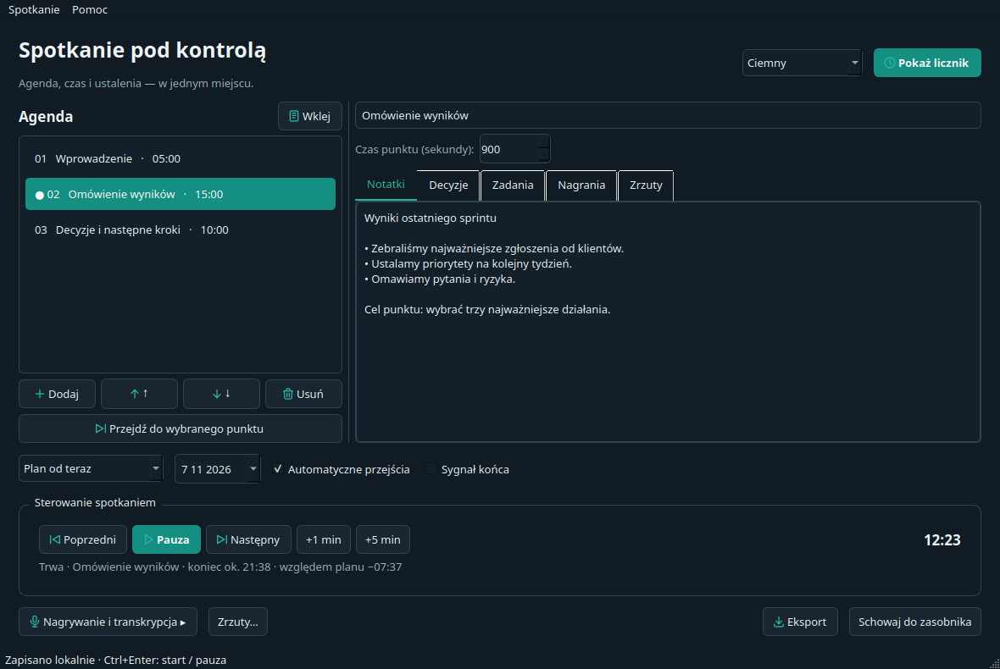
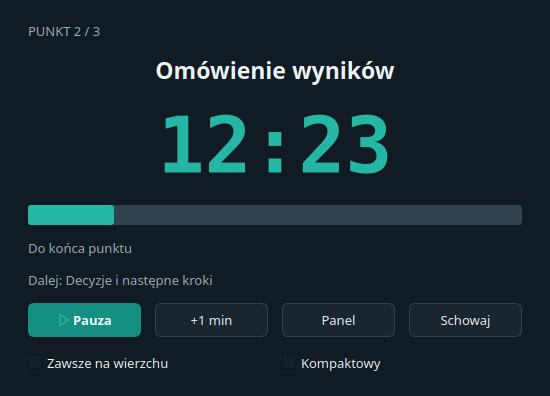
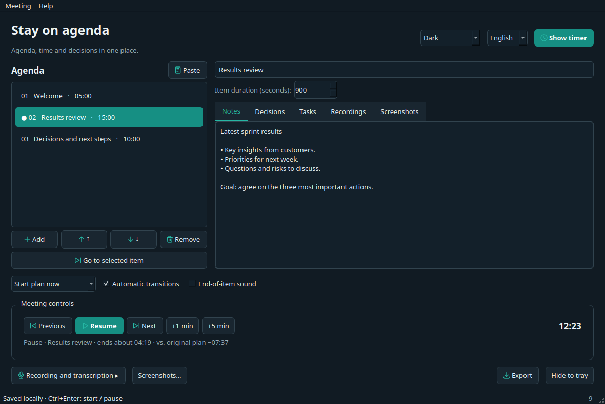
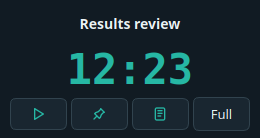

# Meeting Agenda Timer / Licznik spotkaniowy

[Polski](#polski) · [English](#english)

<a id="polski"></a>

## Polski

Lokalne narzędzie desktopowe do odliczania czasu pozostałego do końca
poszczególnych punktów agendy spotkania. Osobny licznik pokazuje tytuł punktu
i pozostały czas, a panel prowadzącego pozwala zapisywać notatki, decyzje i zadania.

**Wersja beta — wersja aplikacji to numer commita (liczba commitów w historii HEAD).** Testy, budowanie oraz uruchomienie paczek przeszły w CI na Windows, macOS
i Linux. Dodatkowo sprawdzono pulpit Linux X11. Mikrofony, uprawnienia
i przechwytywanie obrazu na fizycznych komputerach Windows/macOS wymagają
dalszych testów. Szczegóły: [ROADMAP.md](ROADMAP.md)
i [docs/VALIDATION.md](docs/VALIDATION.md).

### Uruchomienie bez instalatora

Gotową paczkę dla swojego systemu należy rozpakować i uruchomić:

- Windows: `Licznik-Spotkaniowy.exe`.
- macOS: `Licznik-Spotkaniowy.app`.
- Linux: plik wykonywalny `Licznik-Spotkaniowy` w rozpakowanym katalogu.

Nowe paczki Windows i macOS są plikami ZIP z jednym folderem
`Licznik-Spotkaniowy`. W jego głównym katalogu znajdują się odpowiednio
`Licznik-Spotkaniowy.exe` z ikoną programu albo `Licznik-Spotkaniowy.app`
oraz `README.txt`. Pobieraj plik aplikacji z Releases; archiwa „Source code”
zawierają kod, a nie gotowy program. Linux pozostaje w formacie `.tar.gz`.

Paczka zawiera interpreter i biblioteki. Nie wymaga instalowania Pythona,
pip ani venv. Nie przenoś samego pliku wykonywalnego bez towarzyszących bibliotek.
Lokalne wyniki budowania znajdują się w `dist/` i nie są commitowane.
Kod: https://github.com/nocnystroz/MeetingAgendaTimer
Paczki do pobrania: [wydania testowe](https://github.com/nocnystroz/MeetingAgendaTimer/releases).
Nowe paczki budowane z tego kodu zawierają krótkie instrukcje `README.txt` po polsku i angielsku
dopasowane do systemu i wariantu; na macOS plik leży obok aplikacji.
Artefakty udanych przebiegów Actions obejmują Windows x64, macOS Apple Silicon
(ARM64) i Linux x86_64. Obecna macierz CI buduje wariant full; wariant core
można zbudować skryptem poniżej na docelowym systemie. Intel Mac i Windows ARM
nie mają osobnego artefaktu w obecnej macierzy.

Wariant **core** zawiera licznik, notatki, eksport, transkrypcję plików
skompresowanych oraz zrzuty całego ekranu. Wariant **full** dodaje nagrywanie,
przygotowanie WAV do transkrypcji, magazyn klucza i przechwytywanie wybranego
okna. Zainstalowanie modułu nie uruchamia go w tle.

Niepodpisane paczki mogą wywołać komunikat SmartScreen lub Gatekeeper.
Nie zmieniaj globalnej polityki bezpieczeństwa systemu. Obecne paczki lokalne
nie mają podpisu wydawcy ani notaryzacji Apple. Wsparcie Linux zależy także
od systemowych bibliotek pulpitu i serwera dźwięku; sprawdź walidację.

### Uruchomienie ze źródeł

Wymagany Python 3.11+ i [uv](https://docs.astral.sh/uv/). Środowisko projektu to `.venv`.

```bash
uv sync --frozen --extra dev --extra audio --extra keyring --extra capture
uv run python -m meeting_timer
```

Można również użyć `./uruchom.sh` na Linux/macOS lub `./uruchom.ps1`
w PowerShell na Windows po utworzeniu środowiska. Skrypty nie instalują bibliotek
ani nie zmieniają polityki wykonywania. Gdy PowerShell blokuje skrypty, uruchom
bezpośrednio `.venv\Scripts\python.exe -m meeting_timer`.

Alternatywa bez uv: `python -m venv .venv`, a następnie interpreterem z tego
środowiska wykonaj `-m pip install -e ".[audio,keyring,capture,dev]"`.
Na Linux audio wymaga działającego PulseAudio lub PipeWire z kompatybilnością
PulseAudio i biblioteki `libpulse`. Dźwięk systemowy na macOS wymaga dostępnego
źródła loopback/urządzenia wirtualnego; aplikacja nie instaluje sterowników.

### Agenda i sterowanie

Wybierz **Wklej**, wprowadź plan, sprawdź podgląd i zastosuj:

```text
Wprowadzenie — 5 min
Omówienie wyników — 15 min
Decyzje i następne kroki — 10 min
```

Możesz też podać godziny:

```text
10:00–10:05 Wprowadzenie
10:05–10:20 Omówienie wyników
10:20–10:30 Decyzje i następne kroki
```

Możesz wklejać także tabelki z Excela/Sheets (tabulatory), CSV z przecinkiem
lub średnikiem oraz tabelki Markdown. Nagłówki `Temat` i `Czas (min)` pozwalają
podać samą liczbę minut. Obsługiwane są również `15 minut — Wyniki`,
`Wyniki 1h30min`, `Wyniki (00:15:00)` i `Wyniki [15:00]` (MM:SS).

Lista samych godzin rozpoczęcia wyznacza czas punktów na podstawie następnego:

```text
10:00 Wyniki
10:15 Decyzje
10:25 Koniec
```

Ostatni punkt musi mieć czas trwania albo końcowy wiersz `HH:MM Koniec`.
Nierozpoznane linie nie są pomijane. Standardowe nagłówki i separatory tabeli
są rozpoznawane jako struktura.

Czasy trwania obsługują `h`, `godz`, `min`, `m`, `sek`, `s` oraz części minuty,
np. `1,5 min`. Nie mieszaj czasów trwania i przedziałów w jednej agendzie.
Nierozpoznane wiersze wymagają poprawy — nie są pomijane.

- **Start o wskazanej godzinie**: ustaw datę i godzinę dla całego planu; licznik
  czeka do tego momentu. To działa także z agendą zawierającą same czasy trwania.
  Dla startu w przeszłości uwzględnia już upłynięty czas.
- **Plan od teraz**: czas biegnie po naciśnięciu Rozpocznij.
- **Według godzin agendy**: wybierz datę pierwszego punktu; późny start pomija
  upłynięte punkty, a przerwy i oczekiwanie są widoczne w liczniku.
- Pauza zatrzymuje plan. Wznowienie i ręczne przejście przesuwają pozostały
  harmonogram także w trybie godzinowym. Restart umożliwia ponowny start.
- **+1 / +5 min** wydłuża bieżący punkt i prognozę końca. Plan początkowy
  pozostaje punktem odniesienia dla wyświetlanego opóźnienia/przyspieszenia.
- Wyłączenie automatycznych przejść zatrzymuje temat z licznikiem przekroczenia.
  Ponowne włączenie synchronizuje punkt z aktualną pozycją w zmodyfikowanym planie.
- **Ctrl+Enter**: start/pauza; **Ctrl+N**: agenda; **Ctrl+S**: kopia JSON;
  **Ctrl+O**: otwarcie; **Ctrl+E**: eksport; **Ctrl+Q**: zakończenie.

Wybór punktu na liście służy do podglądu i edycji. Licznik przełącza dopiero
**Przejdź do wybranego punktu**, Poprzedni lub Następny. W trakcie można zmieniać
nazwy, czasy i treści oraz przestawiać przyszłe punkty. Usunięte punkty pozostają
w danych bieżącej sesji. Ponowne wklejenie agendy zatrzymuje licznik,
zachowuje stare notatki w danych sesji i nie zatrzymuje osobnego nagrania.

### Licznik i notatki

**Pokaż licznik** otwiera osobne okno z przełącznikami **Zawsze na wierzchu**
i **Kompaktowy**. Widok kompaktowy ma około 260 × 138 px, pokazuje krótki tytuł,
czas i przyciski pauzy, przypinania, panelu oraz powrotu do pełnego widoku. Przełączanie i zmiana motywu nie resetują czasu.
Standardowy przycisk minimalizacji chowa do paska; **Schowaj** do zasobnika.
Przy braku zasobnika aplikacja minimalizuje okno zamiast tracić do niego dostęp.
Zamknięcie licznika przywraca panel prowadzącego.

Notatki, decyzje i zadania przypisane są do stałych identyfikatorów punktów.
Menu **Spotkanie** zawiera zapis kopii, lokalne szablony i eksport Markdown/PDF
z wyborem treści. JSON przechowuje odnośniki do nagrań i PNG, nie ich zawartość.
Po przeniesieniu plików trzeba zachować lub odtworzyć właściwe lokalizacje.

Zapis po edycji następuje po 700 ms, a pozycja działającego licznika co 5 s.
Po awarii program proponuje odzyskanie w pauzie, bez uruchamiania nagrywania/API.
Niezapisane ostatnie zmiany mogą wymagać odtworzenia. Panel do udostępniania
nie wyświetla notatek ani klucza; sam tytuł punktu nadal może być poufny.

### Nagrywanie i transkrypcja

Rozwiń **Nagrywanie i transkrypcja**, poczekaj na automatyczne wykrycie źródeł, wybierz mikrofon i/lub
źródło spotkania oraz przetestuj poziomy. Wybierz miks mono lub rozdzielone
kanały i katalog. **Nagraj** wymaga potwierdzenia; nagranie jest lokalnym WAV
PCM 16-bit / 48 kHz. Osobna pauza audio usuwa te fragmenty z zapisu.
Pauza licznika nie zatrzymuje nagrania. Zmiana źródeł wymaga jawnego nowego segmentu.

Znaczniki punktów zapisują pozycję w nagraniu; znajdziesz je w zakładce
**Nagrania** i pliku `.markers.json`. Każdy segment ma limit ok. 3,8 GB,
po którym trzeba jawnie rozpocząć kolejny. Przy błędzie urządzenia lub dysku
aplikacja zachowuje to, co udało się zapisać; nie gwarantuje odzyskania
ostatniego bloku po awarii zasilania.

Transkrypcja korzysta z OpenAI (`gpt-transcribe`) i wymaga własnego klucza API.
Podanie klucza nie wysyła danych. Wybierz zakończony plik i potwierdź dostawcę,
zakres oraz możliwość kosztów. WAV z aplikacji dzielony jest lokalnie na części
do 5 minut / mono 16 kHz; inne obsługiwane pliki muszą mieścić się w limicie 24 MB.
Nie ma automatycznych ponowień. Przy anulowaniu lub błędzie zachowywane są
odebrane fragmenty, a już naliczonych kosztów nie można cofnąć.

Wynik można poprawić, ręcznie przypisać do punktu i wyeksportować. Gdy API
nie zwraca dokładnych znaczników, program nie przypisuje zdań automatycznie.
Dokumentacja integracji: [OpenAI — file transcription](https://developers.openai.com/api/docs/guides/speech-to-text).

### Automatyczne zrzuty

**Zrzuty…** pozwala wybrać ekran albo wykryte okno, interwał 1–86400 sekund,
limit plików i katalog. PNG zapisuje się na początku, a potem co wskazany czas.
Interwał można zmienić podczas pracy. Limit domyślnie wynosi 200 i zatrzymuje
cykl bez usuwania poprzednich obrazów. Zrzuty są widoczne przy punkcie agendy.

Zamknięcie okna ustawień nie zatrzymuje zrzutów — użyj **Zatrzymaj**.
Stan pozostaje w panelu i zasobniku. Brak uprawnień/obrazu zatrzymuje cykl,
bez zamiany wybranego okna na cały pulpit. Wybrane okno wymaga dodatku capture;
przechwytywanie Waylanda oraz zachowanie okien zminimalizowanych zależą od
backendu/systemu i wymagają dalszych testów. Na macOS może pojawić się prośba
o uprawnienie do nagrywania ekranu. Chroniona treść może być niedostępna.

Zrzuty nie są nagraniem wideo i nigdy nie trafiają do transkrypcji API.

### Dane, testy i budowanie

Katalog danych: Linux `$XDG_DATA_HOME/licznik-spotkaniowy` lub
`~/.local/share/licznik-spotkaniowy`; Windows `%LOCALAPPDATA%/licznik-spotkaniowy`;
macOS `~/Library/Application Support/licznik-spotkaniowy`.
Możesz wskazać inny przez `MEETING_TIMER_DATA_DIR`. Nagrania i zrzuty domyślnie
trafiają do podkatalogów `recordings` i `screenshots`. Otwórz katalog z menu.

```bash
uv run pytest -q
uv run ruff check meeting_timer tests scripts run.py
uv run python scripts/build_portable.py --core
uv run python scripts/build_portable.py
```

Buduj na docelowym systemie i architekturze. Wersja pełna wymaga dodatków
`audio`, `keyring`, `capture`. `.github/workflows/check.yml` przygotowuje testy
oraz budowanie na trzech systemach, bez automatycznego publikowania wydania.

[Prywatność](PRIVACY.md) · [MIT](LICENSE) · [Licencje zależności](THIRD_PARTY.md)
· [Założenia](AGENTS.md) · [UX](docs/UX.md).

Historia spotkań, integracje MS/Google i nagrywanie wideo pozostają odłożone.
Inspiracja funkcjonalna audio: lokalny projekt `audio-rozkminka`; nie kopiowano kodu.


### Identyfikacja wersji

Tytuły okien i prawy koniec paska stanu pokazują numer commita, np. 5.
Numer to wynik git rev-list --count HEAD. Pełny hash jest w podpowiedzi wersji. Wersja źródłowa
odczytuje go z Git; `*` oznacza niezacommitowane zmiany. Paczka przenośna
ma wersję utrwaloną przy budowaniu, także bez dostępu do Git.


### Języki i pierwsze uruchomienie

**Pomoc → Instrukcja obsługi** otwiera lokalny poradnik ze zrzutami i spisem
treści w wybranym języku. **Pomoc → Skróty klawiaturowe…** pozwala zmienić,
wyłączyć lub przywrócić skróty; wykrywa konflikty i zapamiętuje ustawienia
w `shortcuts.json` w katalogu danych. Skróty działają w panelu i liczniku,
gdy aktywne jest okno aplikacji. Menu pokazuje aktualne przypisania.
Pomoc zawiera jedną politykę prywatności, zgłoszenia błędów/opinii na GitHubie
oraz [stronę projektu](https://ion301.com/pl/narzedzia/meeting-agenda-timer/).
Linki zewnętrzne otwierają się dopiero po kliknięciu; aplikacja nie wysyła
automatycznie zgłoszeń ani danych spotkania.

W prawym górnym rogu wybierzesz Polski, English, Deutsch lub Français.
Zmiana działa podczas spotkania i nie tłumaczy ani nie zmienia Twojej agendy,
notatek i transkrypcji. Wybór jest zapamiętywany lokalnie. Eksport używa wybranego
języka nagłówków, zachowując oryginalne treści. README jest po polsku i angielsku; pozostała dokumentacja jest głównie po polsku.
Warunki pierwszego uruchomienia są dostępne w czterech językach.

Pierwsze uruchomienie wymaga zaakceptowania [warunków użytkowania](TERMS.md),
w tym oświadczenia o zgodach uczestników przy nagrywaniu i zrzutach.
Bez zaznaczenia zgody nie otworzy się panel. Zmiana warunków powoduje ponowne
pytanie. Pomoc zawiera warunki, MIT, politykę prywatności i link wsparcia.

[☕ Postaw mi kawę / Buy me a coffee](https://buymeacoffee.com/m.slawinski)


### Podgląd



Widok kompaktowy:



<a id="english"></a>

## English

Portable desktop tool for counting down the time remaining for each meeting
agenda item. A separate timer shows the item title and remaining time; the
presenter panel holds notes, decisions and tasks.

**Beta version — the app version is the commit count (the number of
commits in HEAD history).** CI tests, builds and launches packages on Windows,
macOS and Linux. Linux X11 desktop behavior was also checked. Microphones,
permissions and image capture on physical Windows/macOS computers still need
testing. Details: [ROADMAP.md](ROADMAP.md) and
[docs/VALIDATION.md](docs/VALIDATION.md).

### Run without an installer

Unpack the package for your system and launch:

- Windows: `Licznik-Spotkaniowy.exe`.
- macOS: `Licznik-Spotkaniowy.app`.
- Linux: `Licznik-Spotkaniowy` executable in the unpacked directory.

New Windows and macOS packages are ZIP files containing one
`Licznik-Spotkaniowy` folder. Its top level contains either
`Licznik-Spotkaniowy.exe` with the app icon or `Licznik-Spotkaniowy.app`, plus
`README.txt`. Download the app asset from Releases; “Source code” archives
contain source files rather than a ready-to-run program. Linux uses `.tar.gz`.

Packages include the interpreter and libraries; Python, pip and venv are not
required. Keep the accompanying libraries with the executable. Local build
outputs are in `dist/` and are not committed. Source code:
https://github.com/nocnystroz/MeetingAgendaTimer. Downloads: [test
releases](https://github.com/nocnystroz/MeetingAgendaTimer/releases), or
Actions → a successful build → Artifacts. New packages built from this code include a short
Polish/English `README.txt` tailored to the OS and variant; on macOS it sits
beside the app. Targets: Windows x64, macOS Apple
Silicon (ARM64), Linux x86_64. There is no separate Intel Mac or Windows ARM
artifact in the current matrix. CI currently builds the full variant; core can be
built locally on the target system using the script below.

The **core** package includes the timer, notes, export, compressed-file
transcription and full-screen screenshots. **Full** adds recording, WAV
preparation for transcription, credential storage and selected-window capture.
Installing an optional module does not run it in the background.

Unsigned packages may show SmartScreen or Gatekeeper warnings. Do not change
the system-wide execution policy. Current local packages are not publisher
signed and are not Apple-notarized. Linux support also depends on desktop and
audio-server libraries; see validation notes.

### Run from source

Python 3.11+ and [uv](https://docs.astral.sh/uv/) are required. The project
environment is `.venv`.

```bash
uv sync --frozen --extra dev --extra audio --extra keyring --extra capture
uv run python -m meeting_timer
```

You can also use `./uruchom.sh` on Linux/macOS or `./uruchom.ps1` in Windows
PowerShell after creating the environment. These scripts do not install
libraries or change execution policy. If PowerShell blocks scripts, run
`.venv\Scripts\python.exe -m meeting_timer` directly.

Without uv: run `python -m venv .venv`, then use that environment's Python to
run `-m pip install -e ".[audio,keyring,capture,dev]"`. Linux audio needs a
working PulseAudio or PipeWire server with PulseAudio compatibility and
`libpulse`. System audio on macOS requires an available loopback source or
virtual device; the app does not install drivers.

### Agenda and controls

Choose **Paste**, enter an agenda, review the interpretation preview and
apply it. For example:

```text
Introduction — 5 min
Review results — 15 min
Decisions and next steps — 10 min
```

Clock ranges are also supported:

```text
10:00–10:05 Introduction
10:05–10:20 Review results
10:20–10:30 Decisions and next steps
```

You can paste spreadsheet tables (tabs), comma- or semicolon-separated CSV,
and Markdown tables. Headers such as `Topic` and `Duration (min)` allow a
duration as a bare number. Other accepted forms include `15 minutes — Results`,
`Results 1h30min`, `Results (00:15:00)` and `Results [15:00]` (MM:SS).

A list of start times derives each item's duration from the next start:

```text
10:00 Results
10:15 Decisions
10:25 End
```

The final item needs a duration, or a final `HH:MM End` row. Unrecognized rows
are reported with their line numbers, not silently skipped. Standard headings
and Markdown table separators are recognized. Duration units include `h`,
`hours`, `min`, `m`, `sec` and `s`, including fractional minutes such as
`1.5 min`. Do not mix durations and clock ranges in one agenda.

- **Start at a specific time**: set the date and time for the whole plan; the
  timer waits until then. This also works with duration-only agendas. A past
  start time accounts for elapsed time.
- **Start plan now**: the clock starts when you press Start.
- **Follow agenda times**: choose the first item's date; a late start skips
  elapsed items, and gaps and waiting are shown on the timer.
- Pause stops the plan. Resume and manual item changes shift the remaining
  schedule in clock-time mode too. Restart allows another start.
- **+1 / +5 min** extends the current item and projected finish. The original
  plan remains the baseline for displayed delay/ahead time.
- With automatic transitions off, the timer stays on the item and counts
  overtime. Turning transitions back on synchronizes to the current position
  in the modified plan.
- **Ctrl+Enter**: start/pause; **Ctrl+N**: agenda; **Ctrl+S**: save JSON copy;
  **Ctrl+O**: open; **Ctrl+E**: export; **Ctrl+Q**: quit.

Selecting an item previews and edits it. The timer changes only with **Go to
selected item**, Previous or Next. During a meeting you can rename items, edit
times and text, and reorder future items. Deleted items remain in current
session data. Pasting a new agenda stops the timer, retains old notes in session
data and does not stop a separate recording.

### Timer and notes

**Show timer** opens a separate window with **Always on top** and **Compact**
switches. Compact view is about 260 × 138 px, with a short title, time and
pause, pin, panel and full-view controls. Changing view or theme does not reset
the timer. The standard minimize button minimizes to the taskbar; **Hide** sends
the app to the system tray. If no tray is available, the window is minimized so
the app remains accessible. Closing the timer restores the presenter panel.

Notes, decisions and tasks are attached to stable agenda-item IDs. The
**Meeting** menu provides a saved copy, local templates and Markdown/PDF export
with content selection. JSON stores references to audio and PNG files, not the
files themselves. Keep or restore their locations when moving files.

Edits are saved after 700 ms; a running timer position is saved every 5 seconds.
After a crash, the app offers recovery in a paused state without starting
recording or an API request. The latest unsaved changes may need to be restored.
The shareable view does not show notes or keys, though an item title may still
be confidential.

### Recording and transcription

Expand **Recording and transcription**, wait for sources to be detected, choose
a microphone and/or meeting source, and check levels. Select a mono mix or
separate channels and an output folder. **Record** requires confirmation; audio
is saved locally as 16-bit / 48 kHz PCM WAV. Pausing audio omits that interval
from the recording. Pausing the timer does not pause recording. Changing
sources requires an explicit new segment.

Agenda markers store their position in the recording; find them in the
**Recordings** tab and `.markers.json` file. Each segment is limited to about
3.8 GB; starting another segment is an explicit action. On device or disk
errors, the app keeps data that was successfully written; it cannot guarantee
recovery of the last block after power loss.

Transcription uses OpenAI (`gpt-transcribe`) and requires your own API key.
Entering a key does not send anything. Select a completed file and confirm the
provider, data scope and possible costs before sending. App-created WAV files
are locally split into chunks of up to 5 minutes and converted to mono 16 kHz;
other supported files must be no larger than 24 MB. Requests are not retried
automatically. On cancellation or error, received parts are retained; incurred
costs cannot be reversed. You can edit the result, assign it to an agenda item
manually and export it. If the API does not provide exact timestamps, sentences
are not assigned automatically. See [OpenAI file transcription
documentation](https://developers.openai.com/api/docs/guides/speech-to-text).

### Automatic screenshots

**Screenshots…** lets you choose a screen or detected window, an interval of
1–86400 seconds, a file limit and a folder. A PNG is saved immediately and
then at the chosen interval. You can change the interval while capture runs.
The default limit is 200; reaching it stops capture without deleting existing
images. Screenshots are associated with the agenda item.

Closing the settings window does not stop capture; use **Stop**. Its status
remains visible in the panel and tray. Missing permissions or image data stops
the cycle; a selected window is never silently replaced with the whole desktop.
Selected-window capture requires the capture extra. Wayland capture and
minimized-window behavior depend on the backend/system and need more testing.
macOS may request screen-recording permission. Protected content may not be
available. Screenshots are not video and are never sent to the transcription
API.

### Data, tests and builds

Data folders: Linux `$XDG_DATA_HOME/licznik-spotkaniowy` or
`~/.local/share/licznik-spotkaniowy`; Windows
`%LOCALAPPDATA%/licznik-spotkaniowy`; macOS
`~/Library/Application Support/licznik-spotkaniowy`. Set
`MEETING_TIMER_DATA_DIR` to choose another location. Recordings and screenshots
default to `recordings` and `screenshots` subfolders. Open the folder from the
menu.

```bash
uv run pytest -q
uv run ruff check meeting_timer tests scripts run.py
uv run python scripts/build_portable.py --core
uv run python scripts/build_portable.py
```

Build on the target system and architecture. The full variant needs the
`audio`, `keyring` and `capture` extras. `.github/workflows/check.yml` runs tests
and builds on all three systems; it does not automatically publish releases.

[Privacy policy](PRIVACY.md) (Polish) · [MIT license](LICENSE) ·
[Third-party licenses](THIRD_PARTY.md) · [Project assumptions](AGENTS.md)
(Polish) · [UX notes](docs/UX.md) (Polish).

Meeting history, Microsoft/Google integrations and video recording are deferred.
Audio feature inspiration came from the local `audio-rozkminka` project; its
code was not copied.

### Version identification

Window titles and the right end of the status bar show the commit count, for
example `5`, from `git rev-list --count HEAD`. A tooltip shows the full hash.
Source runs read the version from Git; `*` means there are uncommitted changes.
Portable packages save the version at build time and show it without Git.

### Languages and first launch

**Help → User guide** opens an offline guide with screenshots and chapter
navigation in the selected language. **Help → Keyboard shortcuts…** edits,
disables or restores bindings, detects conflicts and saves preferences in
`shortcuts.json` in the data folder. Shortcuts work in the presenter and timer
while an app window is active. Menus show current bindings.
Help includes one privacy policy, GitHub bug/feedback reporting and the
[project page](https://ion301.com/en/tools/meeting-agenda-timer/).
External links open only after a click; the app does not submit reports or
meeting data automatically.

Choose Polski, English, Deutsch or Français in the upper-right corner. Switching
works during a meeting and does not translate or change your agenda, notes or
transcript. The choice is saved locally. Exports use headings in the selected
language while preserving original content. This README is available in Polish and English; the other project documents
are mainly in Polish. First-launch terms are available in four languages.

On first launch, accept the [English terms of use](https://github.com/nocnystroz/MeetingAgendaTimer/blob/main/meeting_timer/assets/terms.en.md), including the
statement that you have participant consent and required permissions for
recording and screenshots. The meeting panel will not open without acceptance.
Updated terms require acceptance again. Help includes the terms, MIT license,
privacy policy and support link.

[☕ Buy me a coffee](https://buymeacoffee.com/m.slawinski)

### Preview



Compact timer:


