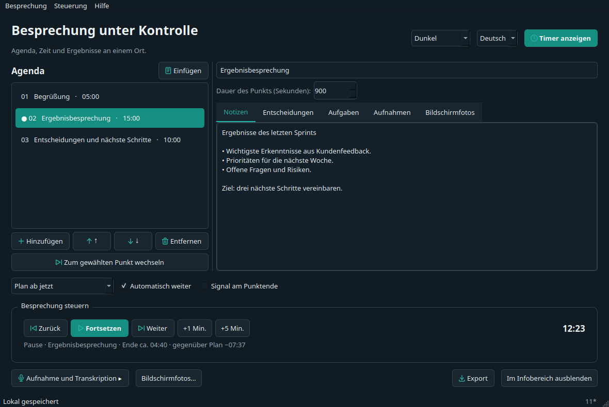
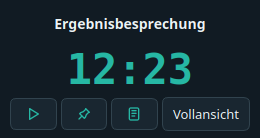

# Meeting Agenda Timer — Bedienungsanleitung

Agenda, Zeit und Ergebnisse an einem Ort. Diese Anleitung funktioniert offline. Wählen Sie links ein Kapitel.

## 1. Erster Start

Entpacken Sie das gesamte Archiv. Windows: **Licznik-Spotkaniowy.exe** im Hauptverzeichnis des entpackten Ordners öffnen. macOS: **Licznik-Spotkaniowy.app** öffnen. Linux: **./Licznik-Spotkaniowy** starten. Python ist nicht erforderlich. Bibliotheken beim EXE belassen; auf macOS das gesamte .app-Paket verschieben.

Akzeptieren Sie die Nutzungsbedingungen und bestätigen Sie die erforderliche Zustimmung der Teilnehmer. Sprache und System-/Hell-/Dunkelmodus wählen Sie oben rechts. README.txt erläutert den Teststatus und die fehlende Herausgebersignatur.

## 2. Agenda einfügen

Klicken Sie auf **Einfügen**, prüfen Sie die Vorschau und übernehmen Sie die Agenda:

```text
Begrüßung — 5 min
Ergebnisbesprechung — 15 min
Entscheidungen und nächste Schritte — 10 min
```

Auch Zeitbereiche wie `10:00–10:15 Ergebnisse`, Tabellen aus Tabellenkalkulationen, CSV und Markdown werden unterstützt. Fehlerhafte Zeilen müssen korrigiert werden. Bei reinen Startzeiten eine Abschlusszeile wie `10:30 Ende` ergänzen.



## 3. Besprechung steuern

Der Plan kann sofort, nach den Agenda-Uhrzeiten oder an einem bestimmten Datum mit Uhrzeit beginnen. Vor einem geplanten Start zeigt der Timer die Wartezeit.

Start/Pause/Fortsetzen behält Notizen bei. Zurück/Weiter wechselt den aktuellen Punkt. **+1/+5 min** verlängert den Punkt und den restlichen Plan. Pause und manuelle Sprünge verschieben auch den Uhrzeitplan; Neustart richtet ihn erneut aus. Automatischen Wechsel, Überzeit und Endsignal können Sie während der Besprechung ändern.

## 4. Timer teilen

**Timer anzeigen** öffnet ein separates Fenster ohne Notizen oder Transkripte. Teilen Sie dieses Fenster; auch der Titel kann vertraulich sein. Immer im Vordergrund und Kompaktansicht setzen den Timer nicht zurück. Minimieren und im Infobereich ausblenden sind separate Aktionen. Über das Symbol kehren Sie zurück oder beenden die App.



## 5. Notizen, Entscheidungen und Aufgaben

Die Auswahl eines Punkts dient der Bearbeitung und Vorschau, ohne den Timer umzuschalten. Zum Wechseln gibt es eine eigene Schaltfläche. Jeder Punkt hat Notizen, Entscheidungen, Aufgaben, Aufnahmen und Screenshots. Aufgaben können Verantwortliche, Fälligkeit und Erledigungsstatus enthalten.

Titel und Reihenfolge lassen sich während des Treffens ändern. Das Ersetzen der Agenda erfordert eine Bestätigung. Das Besprechungsmenü speichert Kopien und Vorlagen und exportiert ausgewählte Inhalte nach Markdown/PDF. Die Sitzung wird lokal gespeichert. Wiederherstellung startet weder Aufnahme noch API-Anfragen automatisch.

## 6. Audio, Transkription und Screenshots

**Full** bietet Aufnahmen: Panel öffnen, Quellen abwarten, Mikrofon/Systemaudio auswählen und Pegel testen. Die Aufnahme startet nur auf Ihre Aktion. Eine Timer-Pause pausiert nicht die Aufnahme. macOS-Systemaudio benötigt eine verfügbare Loopback-Quelle; die App installiert keine Treiber.

Transkription ist optional: abgeschlossene Datei wählen, eigenen OpenAI-Schlüssel eingeben und Upload separat bestätigen. Die Schlüsseleingabe sendet nichts. Gebühren sind möglich; Abbrechen holt gesendete Daten nicht zurück. Core unterstützt komprimierte Dateien, full bereitet auch WAV vor.

Für Screenshots Quelle (Fenster nur in full), Intervall und Limit wählen und ausdrücklich starten. Schließen des Panels stoppt die Serie nicht; verwenden Sie Stopp. Fehlendes Bild oder Berechtigung stoppt die Serie ohne Wechsel zum gesamten Bildschirm. PNG bleiben lokal und gehen nicht an die API. Holen Sie die erforderliche Zustimmung ein.

## 7. Tastenkürzel und Hilfe

**Hilfe → Tastenkürzel…** ändert/deaktiviert Kürzel, erkennt Konflikte und stellt Standardwerte wieder her. Die Besprechungssteuerung gilt standardmäßig global: auch bei aktiver Präsentation oder ausgeblendeter App. Andere Kürzel gelten in den App-Fenstern.

Standardsteuerung: **Ctrl+Alt+Shift** plus Buchstabe:

| Buchstabe | Aktion |
| --- | --- |
| B | Vorheriger Punkt |
| N | Nächster Punkt |
| P | Start / Pause / Fortsetzen |
| U | +1 Minute |
| I | +5 Minuten |
| O | Eigene Minutenzahl (Standard 5, in den Kürzeleinstellungen änderbar) |

Unter macOS bedeutet Ctrl Command (Cmd). Deaktivieren Sie die globale Steuerung, um Kürzel auf App-Fenster zu beschränken. Beim Beenden werden die Kürzel freigegeben, während der Bearbeitung vorübergehend ausgesetzt. Prüfen Sie vor der Präsentation den Status: belegte Kombinationen können vom System gesperrt werden. Windows, macOS und Linux X11 werden unterstützt. Die Wayland-Portal-Unterstützung steht noch aus; dort bleiben lokale Kürzel verfügbar. F1 öffnet die Anleitung; Menüs zeigen aktuelle Zuweisungen.

Die Hilfe enthält eine Datenschutzerklärung, Bedingungen, MIT, Projektseite, Fehlermeldung und Unterstützung. Rückmeldungen öffnen GitHub im Browser: Betriebssystem, Version und Schritte angeben, keine API-Schlüssel oder vertraulichen Inhalte. Nichts wird automatisch gesendet.

[Projektseite](https://ion301.com/pl/narzedzia/meeting-agenda-timer/) · [Downloads und Quellcode](https://github.com/nocnystroz/MeetingAgendaTimer) · [Fehler melden / Feedback senden](https://github.com/nocnystroz/MeetingAgendaTimer/issues/new/choose)
