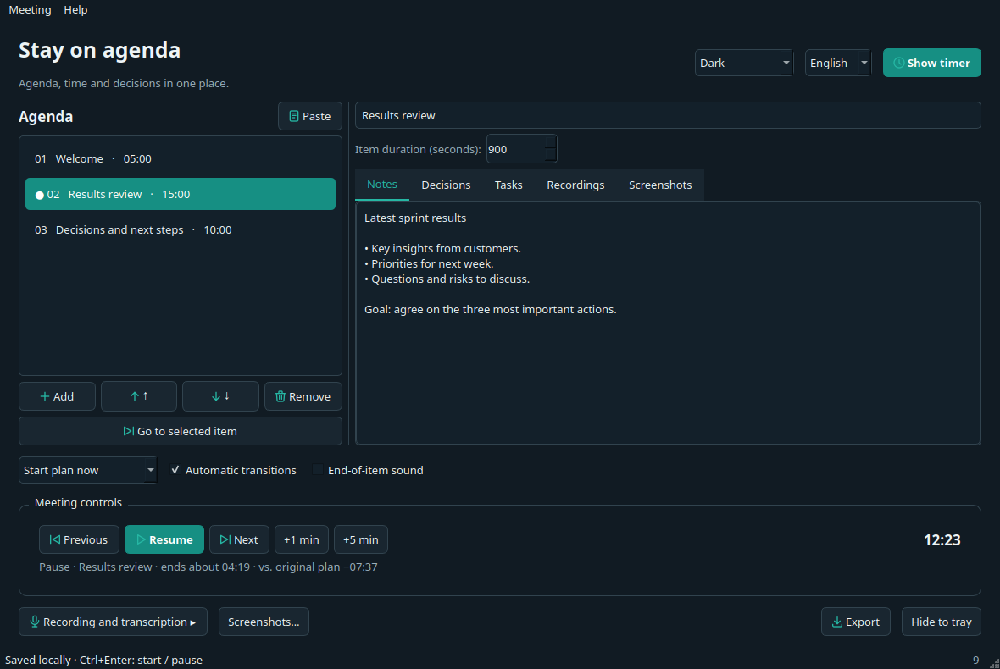
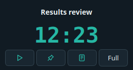

# Meeting Agenda Timer — user guide

Stay on agenda: timing, notes and decisions in one place.
This guide works offline. Select a chapter on the left.

## 1. First launch

Extract the entire archive. Windows: open **Licznik-Spotkaniowy.exe** at the top of the extracted folder. macOS: open **Licznik-Spotkaniowy.app**. Linux: run **./Licznik-Spotkaniowy**. Python is not required. Keep the libraries beside the EXE; on macOS move the entire .app bundle.

Accept the terms and confirm participants' required consent. Choose your language and system/light/dark theme in the top right. The archive's README.txt explains the test status and unsigned packages.

## 2. Paste an agenda

Click **Paste**, review the preview and apply. Example:

```text
Welcome — 5 min
Results review — 15 min
Decisions and next steps — 10 min
```

You can also paste ranges such as `10:00–10:15 Results`, spreadsheet rows, CSV or Markdown tables. Correct any invalid rows. With start times only, add a final line such as `10:30 End`.



## 3. Run the meeting

**Start plan now** counts from Start. **Follow agenda times** aligns with the clock agenda for the selected day. **Start at a specific time** sets the date/time for the entire plan and shows a waiting countdown beforehand.

Start/pause/resume preserves your notes. Previous/Next changes the current item. **+1/+5 min** extends the item and the remaining plan. Pause and manual jumps shift the schedule even in clock mode; Restart lets you align the plan again.

Switch automatic transitions to overtime mode, or enable the end sound. You can change these settings during the meeting.

## 4. Share the timer

**Show timer** opens a separate window without notes or transcripts. Share that window in your meeting app; the item title may itself be confidential. **Always on top** and **Compact view** preserve the countdown. Minimize and hide to tray are separate actions. The tray icon restores the presenter or exits the application.



## 5. Notes, decisions and tasks

Selecting an agenda item previews/edits it; it does not change the timer. Use the separate jump button to switch. Each item has tabs for notes, decisions, tasks, recordings and screenshots. Tasks can have an owner, a due date and a completion state.

Edit titles/order during the meeting. Pasting a replacement agenda requires confirmation; use item editing for small changes. The Meeting menu saves copies and templates and exports selected content to Markdown/PDF. The current session is saved locally; crash recovery never resumes recording or API requests.

## 6. Audio, transcription and screenshots

The **full** variant supports recording: open the panel, wait for sources, select microphone/system audio and test levels. Recording starts only after your action. Pausing the timer does not pause recording. System audio on macOS needs an available loopback source; the app installs no drivers.

Transcription is optional: select a completed file, enter your own OpenAI key and separately confirm the upload. Entering a key sends nothing. The provider may charge you; cancellation cannot retract uploaded data. Core accepts compressed files; full also prepares WAV audio.

**Screenshots…**: choose a screen or window (full), interval and limit, then start explicitly. Closing the settings does not stop capture; use Stop. Missing permission/image stops capture without falling back to the whole screen. Images stay local and are not sent to the API. Obtain the required consent before recording or capturing images.

## 7. Shortcuts and help

**Help → Keyboard shortcuts…** edits/disables bindings, detects conflicts and restores defaults. Changes work in both windows and are stored locally. Shortcuts apply within the app, not globally. Defaults: Ctrl+Enter starts/pauses, Ctrl+L shows the timer, F1 opens this guide. Menus show current bindings.

Help includes one privacy policy, terms, MIT, the project page, issue reporting and support. Feedback opens GitHub in your browser: include OS, version and reproduction steps, without API keys or private meeting content. Nothing is submitted automatically.

[Project page](https://ion301.com/pl/narzedzia/meeting-agenda-timer/) · [Downloads and source](https://github.com/nocnystroz/MeetingAgendaTimer) · [Report a bug / Send feedback](https://github.com/nocnystroz/MeetingAgendaTimer/issues/new/choose)
