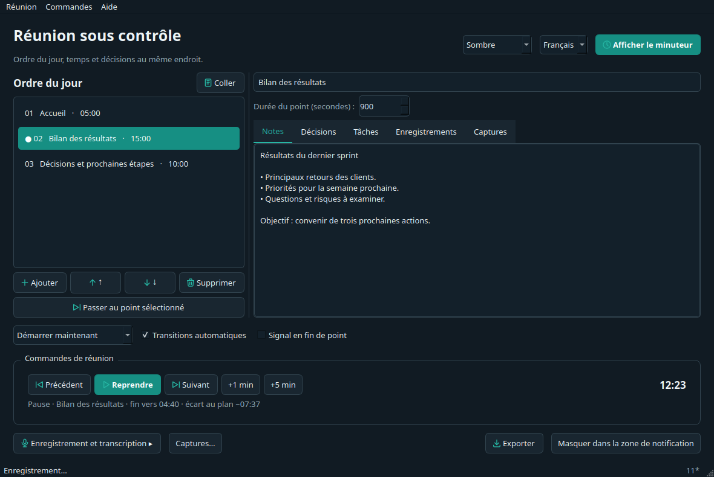
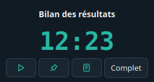

# Meeting Agenda Timer — mode d’emploi

Ordre du jour, temps et décisions au même endroit. Ce guide fonctionne hors ligne. Choisissez un chapitre à gauche.

## 1. Premier lancement

Décompressez toute l’archive. Windows : ouvrez **Licznik-Spotkaniowy.exe** à la racine du dossier extrait. macOS : ouvrez **Licznik-Spotkaniowy.app**. Linux : lancez **./Licznik-Spotkaniowy**. Python n’est pas nécessaire. Conservez les bibliothèques près de l’EXE ; sur macOS, déplacez le paquet .app entier.

Acceptez les conditions et confirmez les consentements nécessaires des participants. Choisissez la langue et le thème système/clair/sombre en haut à droite. README.txt précise le statut de test et l’absence de signature d’éditeur.

## 2. Coller l’ordre du jour

Cliquez sur **Coller**, vérifiez l’aperçu et appliquez :

```text
Accueil — 5 min
Bilan des résultats — 15 min
Décisions et prochaines étapes — 10 min
```

Les plages comme `10:00–10:15 Bilan`, les tableaux de tableur, CSV et Markdown sont acceptés. Corrigez les lignes non reconnues. Pour une liste d’heures de début, ajoutez une dernière ligne telle que `10:30 Fin`.



## 3. Animer la réunion

Le plan peut commencer immédiatement, suivre les heures de l’ordre du jour ou démarrer à une date et heure choisies. Un compte à rebours d’attente précède le démarrage programmé.

Démarrer/pause/reprendre conserve les notes. Précédent/Suivant change le point courant. **+1/+5 min** prolonge le point et le reste du plan. Pause et changement manuel décalent aussi le planning horaire ; Redémarrer permet de le resynchroniser. Vous pouvez modifier les transitions automatiques, le dépassement et le signal de fin pendant la réunion.

## 4. Partager le minuteur

**Afficher le minuteur** ouvre une fenêtre séparée sans notes ni transcriptions. Partagez cette fenêtre ; le titre peut aussi être confidentiel. Toujours au premier plan et Vue compacte ne réinitialisent pas le temps. Réduire et masquer dans la zone de notification sont des actions distinctes. L’icône permet de revenir ou de quitter.



## 5. Notes, décisions et tâches

Sélectionner un point affiche ses données sans changer le minuteur. Utilisez le bouton de changement dédié. Chaque point possède notes, décisions, tâches, enregistrements et captures. Une tâche peut avoir un responsable, une échéance et un état terminé.

Modifiez titres et ordre pendant la réunion. Remplacer l’ordre du jour demande confirmation. Le menu Réunion enregistre copies et modèles et exporte les éléments sélectionnés en Markdown/PDF. La session est sauvegardée localement. La récupération après incident ne relance ni enregistrement ni requête API.

## 6. Audio, transcription et captures

**Full** propose l’enregistrement : ouvrez le panneau, attendez les sources, choisissez micro/audio système et testez les niveaux. Le démarrage demande une action explicite. La pause du minuteur ne suspend pas l’audio. L’audio système macOS exige une source loopback disponible ; l’application n’installe aucun pilote.

La transcription est facultative : choisissez un fichier terminé, entrez votre clé OpenAI et confirmez séparément l’envoi. Saisir la clé n’envoie rien. Le service peut être payant ; annuler ne rappelle pas les données envoyées. Core accepte les fichiers compressés ; full prépare aussi le WAV.

Pour les captures, choisissez écran ou fenêtre (full), intervalle et limite, puis démarrez explicitement. Fermer le panneau n’arrête pas la série : utilisez Arrêter. Une image ou autorisation manquante stoppe la capture sans basculer sur tout l’écran. Les PNG restent locaux et ne sont pas envoyés à l’API. Obtenez les consentements nécessaires.

## 7. Raccourcis et aide

**Aide → Raccourcis clavier…** modifie/désactive les raccourcis, détecte les conflits et restaure les valeurs par défaut. Les commandes de réunion sont globales par défaut : elles fonctionnent pendant une présentation ou lorsque l’application est masquée. Les autres raccourcis concernent ses fenêtres.

Commandes par défaut : **Ctrl+Alt+Shift** avec une lettre :

| Lettre | Action |
| --- | --- |
| B | Point précédent |
| N | Point suivant |
| P | Démarrer / pause / reprendre |
| U | +1 minute |
| I | +5 minutes |
| O | Minutes personnalisées (5 par défaut, modifiables dans les réglages) |

Sur macOS, Ctrl signifie Command (Cmd). Décochez les commandes globales pour limiter les raccourcis aux fenêtres de l’application. Les raccourcis sont libérés à la fermeture et suspendus pendant leur modification. Vérifiez leur état avant de présenter : une combinaison déjà utilisée peut être bloquée par le système. Windows, macOS et Linux X11 sont pris en charge. Le portail de raccourcis globaux Wayland reste à implémenter ; les raccourcis locaux y restent disponibles. F1 ouvre le guide ; les menus affichent les combinaisons actuelles.

L’aide contient une politique de confidentialité, les conditions, MIT, la page du projet, les signalements et le soutien. Les retours ouvrent GitHub dans le navigateur : indiquez système, version et étapes, sans clé API ni contenu privé. Aucun signalement n’est envoyé automatiquement.

[Page du projet](https://ion301.com/pl/narzedzia/meeting-agenda-timer/) · [Téléchargements et code](https://github.com/nocnystroz/MeetingAgendaTimer) · [Signaler un bug / Donner un avis](https://github.com/nocnystroz/MeetingAgendaTimer/issues/new/choose)
