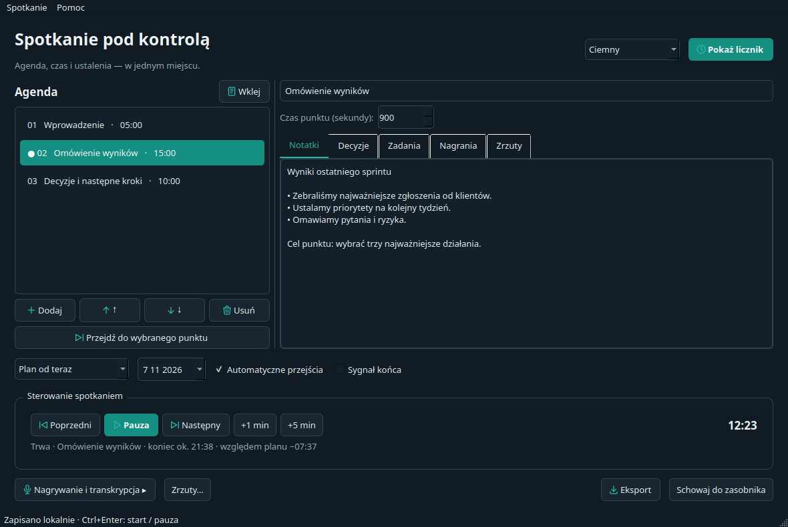
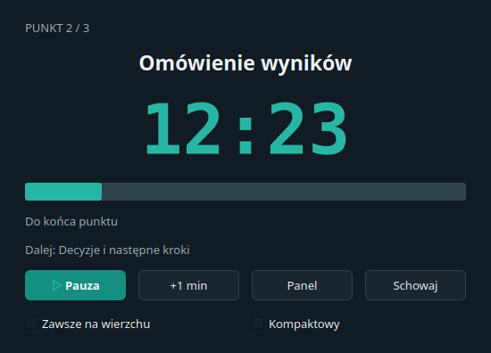

# Licznik spotkaniowy — instrukcja obsługi

Spotkanie pod kontrolą: agenda, czas i ustalenia w jednym miejscu.
Instrukcja działa bez internetu. Rozdział wybierzesz po lewej stronie.

## 1. Pierwsze uruchomienie

Rozpakuj całe archiwum. Windows: otwórz **Licznik-Spotkaniowy.exe** w głównym katalogu folderu. macOS: otwórz **Licznik-Spotkaniowy.app**. Linux: uruchom **./Licznik-Spotkaniowy**. Nie musisz instalować Pythona. Zachowaj biblioteki obok EXE; na macOS przenoś cały pakiet .app.

Zaakceptuj warunki i wymagane zgody uczestników. W prawym górnym rogu wybierz język i motyw: systemowy, jasny lub ciemny. Testowy charakter paczek i brak podpisu opisuje README.txt dołączone do archiwum.

## 2. Wklejanie agendy

Kliknij **Wklej**, sprawdź podgląd i zastosuj. Przykłady:

```text
Wprowadzenie — 5 min
Omówienie wyników — 15 min
Decyzje i następne kroki — 10 min
```

Możesz też wkleić przedziały `10:00–10:15 Wyniki`, tabelę z arkusza, CSV lub Markdown. Błędne wiersze wymagają poprawy. Dla samych godzin rozpoczęcia dodaj na końcu np. `10:30 Koniec`.



## 3. Prowadzenie spotkania

**Plan od teraz** odlicza po naciśnięciu Start. **Według godzin agendy** synchronizuje start z planem godzinowym wybranego dnia. **Start o wskazanej godzinie** ustawia datę i godzinę całego planu; do startu wyświetla oczekiwanie.

Start/pauza/wznowienie nie usuwa notatek. Przyciski Poprzedni/Następny zmieniają bieżący punkt. **+1/+5 min** wydłuża punkt i pozostały plan. Pauza i ręczne przejście przesuwają harmonogram także w trybie godzinowym; Restart pozwala ponownie zsynchronizować plan.

Możesz przełączyć automatyczne przejścia na licznik przekroczenia czasu oraz włączyć sygnał końca. Ustawienia można zmieniać podczas spotkania.

## 4. Licznik do udostępniania

**Pokaż licznik** otwiera osobne okno bez notatek i transkrypcji. Udostępniaj w komunikatorze to okno; tytuł punktu też może być poufny. **Zawsze na wierzchu** i **Widok kompaktowy** działają bez resetowania czasu. Minimalizacja i schowanie do zasobnika to oddzielne akcje. Ikona w zasobniku pozwala wrócić do panelu lub zakończyć program.



## 5. Notatki, decyzje i zadania

Wybór punktu na liście służy do edycji i podglądu; nie przełącza licznika. Do ręcznego przejścia użyj osobnego przycisku. Każdy punkt ma zakładki notatek, decyzji, zadań, nagrań i zrzutów. Zadanie może mieć osobę odpowiedzialną, termin i stan wykonania.

Nazwy i kolejność można zmieniać w trakcie. Ponowne wklejenie agendy wymaga potwierdzenia; nie traktuj go jak edycji pojedynczego punktu. Menu Spotkanie pozwala zapisać kopię, szablon i wyeksportować wybrane treści do Markdown/PDF. Bieżąca sesja zapisuje się lokalnie; odzyskiwanie po awarii nie wznawia nagrywania ani API.

## 6. Audio, transkrypcja i zrzuty

Wariant **full** umożliwia nagrywanie: otwórz panel, poczekaj na źródła, wybierz mikrofon/dźwięk systemowy i przetestuj poziomy. Nagranie rozpoczyna się wyłącznie po Twojej akcji. Pauza licznika nie pauzuje nagrania. Dźwięk systemowy na macOS wymaga dostępnego źródła loopback; aplikacja nie instaluje sterowników.

Transkrypcja jest opcjonalna: wybierz zakończony plik, podaj własny klucz OpenAI i osobno zatwierdź wysłanie audio. Podanie klucza niczego nie wysyła. Usługa może pobierać opłaty; anulowanie nie cofa wysłanych danych. Core obsługuje pliki skompresowane, full przygotowuje też WAV.

**Zrzuty…**: wybierz ekran albo okno (full), interwał i limit. Włącz cykl jawnie. Zamknięcie panelu nie kończy cyklu; użyj Stop. Brak uprawnień/obrazu zatrzymuje zapis bez przełączenia na cały ekran. Zrzuty są lokalne i nie trafiają do API. Nagrywaj i utrwalaj obraz tylko z wymaganymi zgodami.

## 7. Skróty i pomoc

**Pomoc → Skróty klawiaturowe…** pozwala zmienić lub wyłączyć skrót, wykrywa konflikty i przywraca domyślne. Zmiany działają w obu oknach i zapisują się lokalnie. To skróty aplikacji, nie globalne skróty systemu. Domyślnie Ctrl+Enter: start/pauza, Ctrl+L: licznik, F1: instrukcja; aktualne przypisania zobaczysz w menu.

Menu Pomoc zawiera jedną politykę prywatności, warunki, MIT, stronę projektu, zgłoszenia błędów i wsparcie. Zgłoszenie otwiera GitHub w przeglądarce: opisz system, wersję i kroki odtworzenia, bez kluczy API i prywatnej treści spotkania. Nic nie jest wysyłane automatycznie.

[Strona projektu](https://ion301.com/pl/narzedzia/meeting-agenda-timer/) · [Pobieranie i kod](https://github.com/nocnystroz/MeetingAgendaTimer) · [Zgłoś błąd / Przekaż opinię](https://github.com/nocnystroz/MeetingAgendaTimer/issues/new/choose)
